# `radpareto-engine`

**Closed-Loop AAPM TG-233 Task-Based Image Quality × Organ & Peak-Skin-Dose Pareto Protocol Optimization Engine with Frontier Agent Harness & MCP Server**

[](https://www.python.org/)
[%20%7C%20Personal%20Use-3B5B7E?style=flat-square&labelColor=173B63)](LICENSE)
[](NOTICE)
[](DATA_SOURCES_AND_CITATIONS.md)
[-D97706?style=flat-square&labelColor=173B63)](src/radpareto_engine/harness/mcp_server.py)
[](docs/AUDIT_REPORT.md)
[](pyproject.toml)

> **LICENSE & RESEARCH SOFTWARE NOTICE — NON-COMMERCIAL ONLY & NOT A MEDICAL DEVICE.** `radpareto-engine` is licensed strictly for **non-commercial academic/scientific research (with mandatory citation per [`CITATION.cff`](CITATION.cff)) and private personal use only** — **no commercial use is permitted** without a separate written license (see [`LICENSE`](LICENSE)). It has **not** been cleared or approved by the FDA, EU MDR, or any regulatory authority, and **must not** be used for clinical diagnosis, automated scanner exposure control, or unverified clinical dose reporting without Qualified Medical Physicist (QMP) commissioning.

---

## Why `radpareto-engine`?

Consumer AI chat interfaces cannot ingest binary DICOM phantoms or DICOM Radiation Dose Structured Reports (RDSR), verify discrete Parseval noise-power conservation, ray-cast multi-angle C-arm fluoroscopy beams onto 3D patient entrance skin, or enforce real X-ray tube current/power/heat saturation ceilings while solving exact inverse Dose–Detectability frontiers.

`radpareto-engine` solves this end-to-end with strictly typed **Pydantic v2** Physics IR, **cryptographic SHA-256 provenance**, **5 hard `AbstentionCode` safety gates**, an autonomous **Critic-Verifier Agent Harness**, and a zero-bloat **JSON-RPC 2.0 stdio MCP server**.

---

## System Architecture

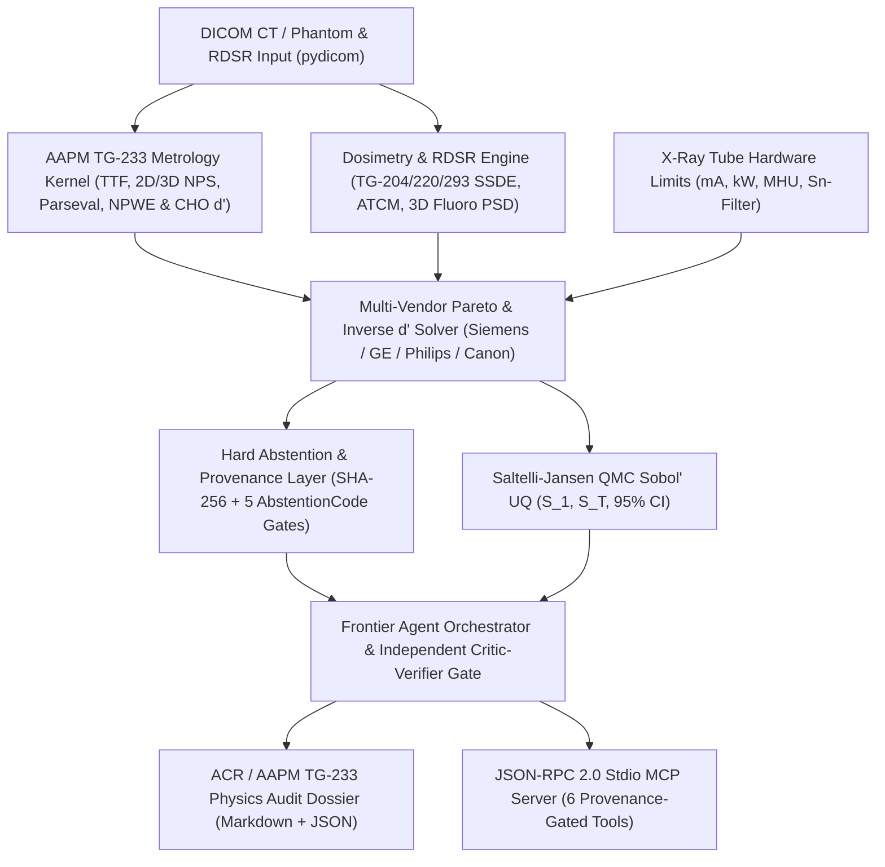

---

## Verified Benchmark & Independent Audit Dashboard

All metrics below are deterministically reproduced by `scripts/run_benchmarks_and_figures.py` and independently verified by `scripts/run_independent_audit.py` (see [`docs/AUDIT_REPORT.md`](docs/AUDIT_REPORT.md)).

| Benchmark / Verification Domain | Metric | Verified Result | Reference / Gate |
|---|---|---|---|
| **AAPM TG-233 Parseval Invariant** | Max discrete 2D NPS integral vs. variance error ($n=12$) | **`2.93e-16`** | Tolerance `< 0.02` (`PARSEVAL_NPS_VIOLATION`) |
| **Closed-Form $d'$ Scaling** | Max error for $d'(2C)=2d'(C)$ and $d'(4\cdot\mathrm{NPS})=0.5\,d'$ | **`2.02e-16`** | Exact quantum-limited NPWE identity |
| **Nonlinear IR Resolution Shift** | MBIR $f_{50}$ High (+500 HU) vs. Low (+45 HU) contrast | **`0.42 → 0.34 mm⁻¹`** | AAPM TG-233 contrast-dependent TTF |
| **Iodine CTA Spectral Pareto** | 2 mm vessel ($d'=6.0$, $D_w=27\text{ cm}$): `80 kVp DLR` vs `140 kVp FBP` | **`1.71 vs. 18.20 mGy`** | `-90.6%` exact inverse CTDIvol solve |
| **3D Fluoroscopy PSD (RDSR)** | 6-event CTO-PCI RDSR round-trip Peak Skin Dose | **`6.22 Gy`** (`53 cm² > 5 Gy`) | NCRP 168 / ICRP 120 `FOLLOWUP_5GY` tier |
| **Multi-Vendor Fleet Drift Audit** | 6-scanner fleet (Siemens, GE, Philips, Canon) | **`-41.5%` mean CTDIvol** | Compliance `3/6 → 6/6`; **6/6 Critic-Verifier APPROVED** |
| **Saltelli–Jansen Sobol' UQ** | Analytical Ishigami accuracy ($N_{\text{base}}=1024$) | **Max err `0.0124`** | Saltelli 2010 / Jansen 1999 QMC |
| **Public Open-License CT Sample** | `data/public_ct_sample/CT_small.dcm` (MIT) | **$D_w = 8.72\text{ cm}$** | SHA-256 verified against `MANIFEST.json` |
| **Hard Safety Abstention Gates** | Adversarial trigger suite across all 5 `AbstentionCode`s | **`5 / 5` FIRED** | Zero silent bypasses |
| **3D Volumetric NPS Parseval** | Full 3D FFT $\mathrm{NPS}_{3D}(f_x, f_y, f_z)$ variance check | **`< 1e-15`** | Exact 3D Parseval conservation |
| **Empirical Scanner Calibration** | Phantom-to-surrogate regression fit ($n=6$ scans) | **$R^2_{\text{noise}} = 1.000$, $R^2_{f_{50}} = 0.992$** | RMS $d'$ error `0.31` |
| **Joint Multi-Task Pareto & VMI** | Simultaneous Liver + CTA compliance & PCCT VMI UHR | **`6.68 mGy`** joint min; **PCCT 40 keV $d'=21.0$** | Binding-task guardrail + K-edge peak |
| **Longitudinal ATCM & QA CUSUM** | $z$-axis ATCM DLP savings & 30-session SQLite CUSUM | **`-44.8%` DLP**; **Alert at Session 20** | Tube aging onset at Session 18 caught in 2 runs |
| **Multi-Procedure Cranial PSD** | 3 staged neuro-angiography runs (120-day window) | **`15.8 Gy`** strict vs. **`12.7 Gy`** repair-weighted | TJC $\ge 15\text{ Gy}$ sentinel gate |
| **In-Vivo GNL & Bowtie Off-Centering** | Phantom-free GNL, air-skin TTF & `-3.8 cm` table offset | **GNL `12.8 HU`**, **`+58.9%` avoidable waste** | Christianson 2015 / Sanders 2016 / Habibzadeh 2012 |
| **Counterfactual Dose Digital Twin** | Correlated CT-NPS reduced-dose virtual-lesion spatial CHO | **ALARA cliff `3.1 mGy` (`-74%`)** | Captures real anatomical + quantum background |
| **Cross-Vendor Protocol Compiler** | Siemens Force → GE Apex / Philips Incisive / Canon Aquilion | **GE `NI 25.7` (`-41.3%` SSDE)**; **100% $d'(D_w)$ match** | Native console knobs + QMP Markdown/CSV diff |

---

## Publication-Grade Visuals (300-DPI PNG & Vector PDF)

All 6 figures follow *Medical Physics* / *Radiology* styling with the colorblind-safe Okabe–Ito palette, physical scalebars, bold panel labels, and cryptographic SHA-256 provenance footers.

### 1. AAPM TG-233 Nonlinear Phantom Metrology (TTF, 2D/1D NPS, NPWE & CHO $d'$)
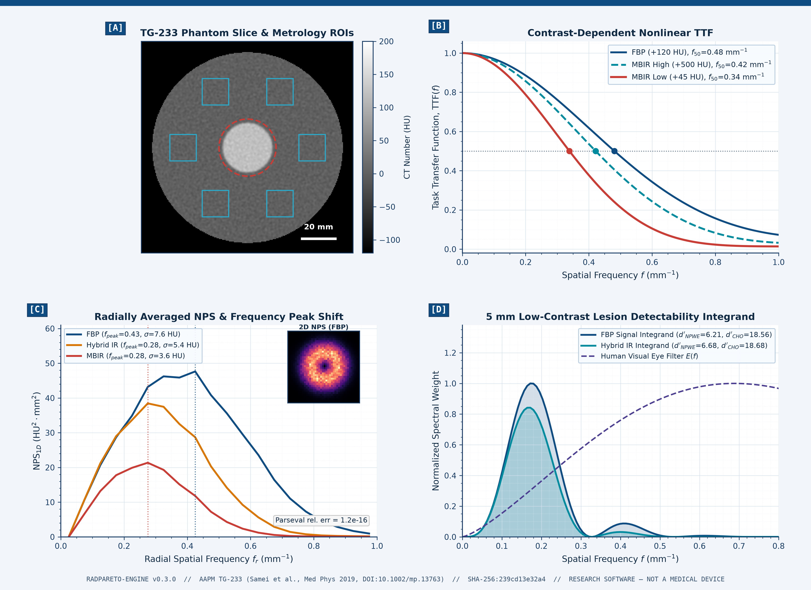

### 2. Habitus-Stratified Dose–Detectability Pareto Frontiers & Tube Saturation Boundary
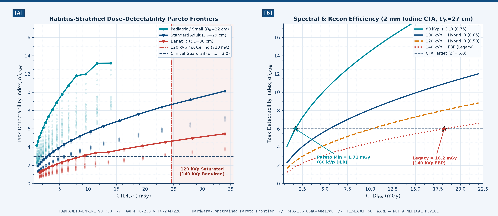

### 3. 3D Patient-Surface Fluoroscopy Peak Skin Dose (PSD) Map from DICOM RDSR
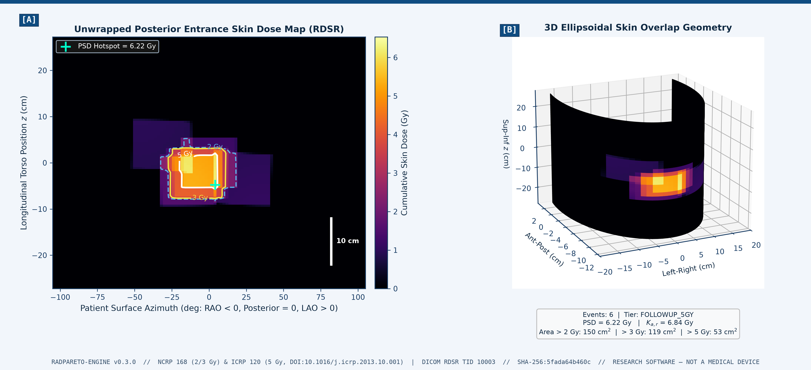

### 4. Autonomous Multi-Vendor Fleet Protocol Drift Audit & Critic-Verifier Gate
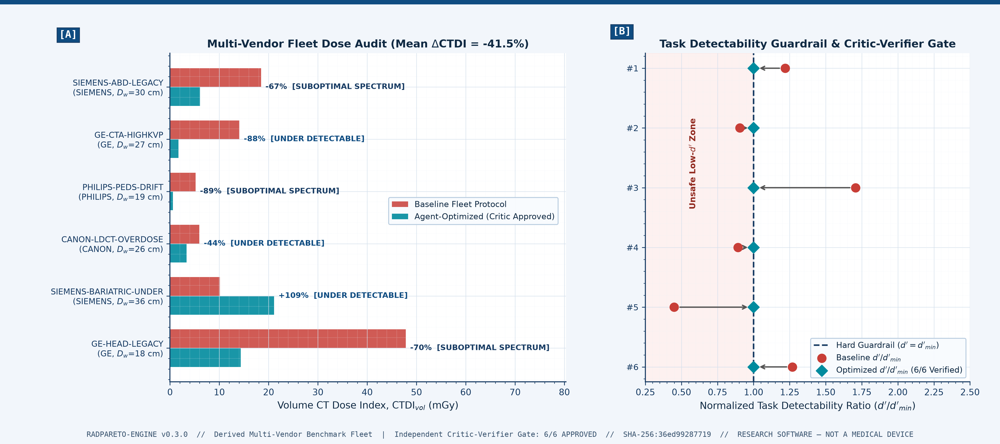

### 5. Saltelli–Jansen Global Sobol' Sensitivity & 2D ($D_w \times \text{CTDI}_{\text{vol}}$) Phase Diagram
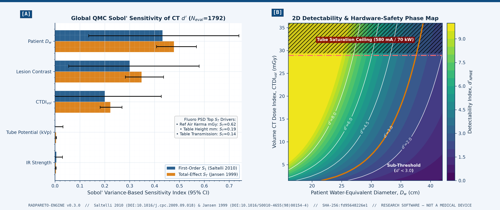

### 6. Public Open-License CT Calibration, Multi-Habitus SSDE & Formal Invariant Verification
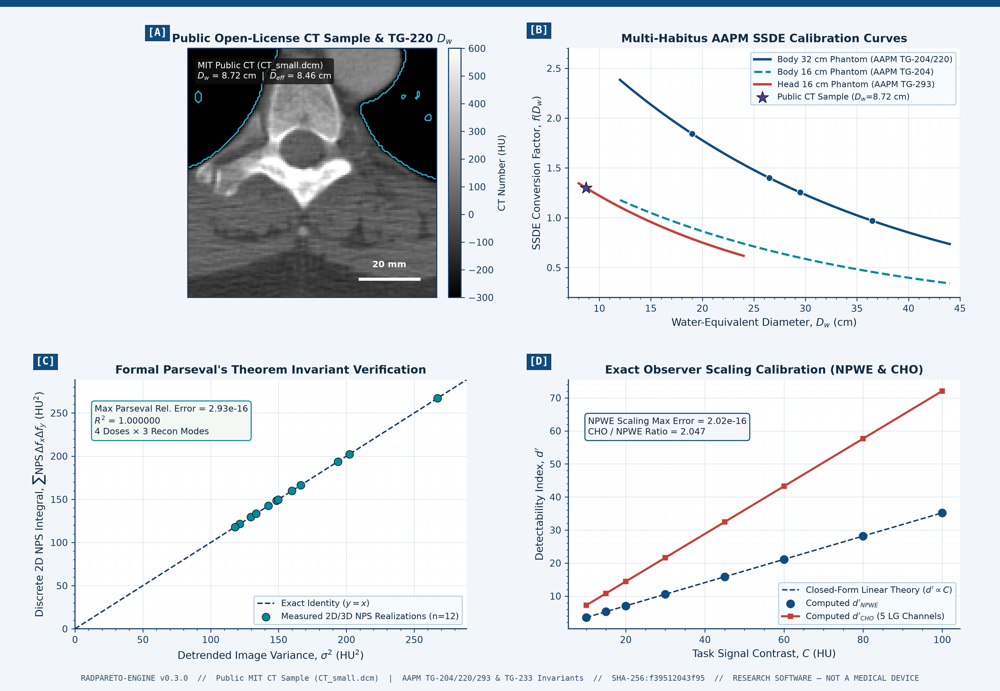

### 7. Empirical Scanner Calibration, Joint Multi-Task Pareto & PCCT/DECT Spectral VMI (`v0.2.0`)
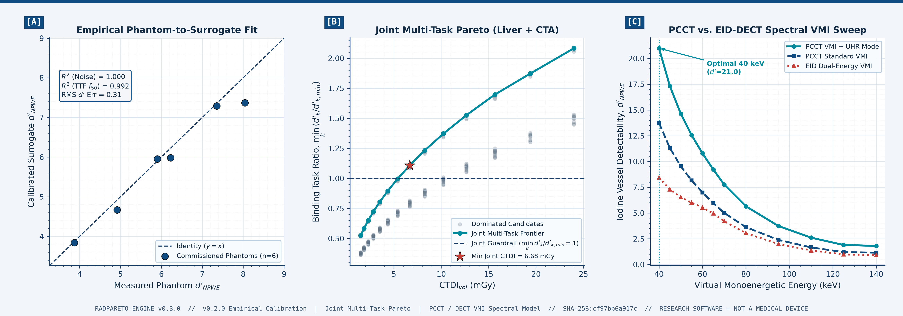

### 8. Longitudinal SQLite TG-233 QA CUSUM Drift Monitor & Multi-Procedure Cranial PSD (`v0.2.0`)
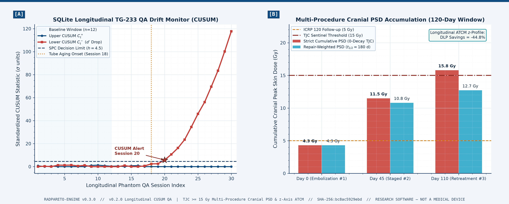

### 9. In-Vivo Patient Metrology, Bowtie Off-Centering Penalty & Counterfactual Dose Digital Twin (`v0.3.0`)
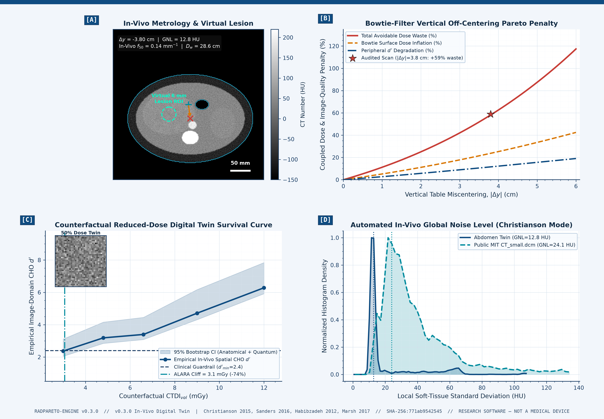

### 10. Cross-Vendor Equi-Detectability Protocol Compiler Across Siemens / GE / Philips / Canon (`v0.3.0`)
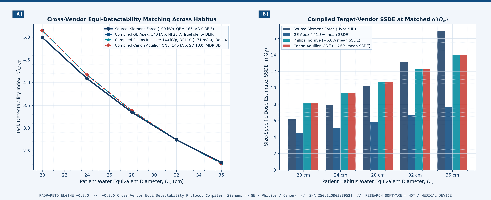

---

## Quickstart (`uv` + Python 3.12)

```bash
# 1. Install package and dev tools with uv
uv sync --extra dev --python 3.12

# 2. Verify public MIT CT sample + SHA-256 manifest
uv run python scripts/fetch_public_ct_sample.py

# 3. Unified CLI (`radpareto`) quick runs
uv run radpareto tg233 --recon hybrid_ir --ctdi 10
uv run radpareto pareto --dw 29 --multitask
uv run radpareto psd results/benchmark_cto_pci_rdsr.dcm --geometry torso
uv run radpareto audit
uv run radpareto qa-check --sessions 30 --drift-onset 18
uv run radpareto invivo --ctdi 12.0 --offset-cm -3.8
uv run radpareto compile --from-vendor siemens --to-vendor ge --kvp 100 --ref-mas 165

# 4. Run full test suite (strict warnings + Hypothesis fuzzing) & lint
uv run pytest --cov=radpareto_engine --cov-report=term-missing
uv run ruff check src tests scripts

# 5. Reproduce all 10 publication figures & 18-check independent audit
uv run python scripts/run_benchmarks_and_figures.py
uv run python scripts/run_independent_audit.py
```

---

## Collapsible Workflows (Python API & MCP Server)

<details>
<summary><strong>Python API: Exact Inverse Minimum-Dose Solve & Multi-Vendor Fleet Audit</strong></summary>

```python
from radpareto_engine.ir import ClinicalTaskSpec, CTProtocolSpec, CTVendor, ReconMode
from radpareto_engine.pareto_optimizer import invert_min_dose_for_dprime
from radpareto_engine.harness.agent_orchestrator import audit_and_optimize_protocol_fleet

protocol = CTProtocolSpec(
    protocol_id="ABD-HYBRID-IR",
    scanner_name="Siemens SOMATOM Force",
    vendor=CTVendor.SIEMENS,
    kvp=100.0,
    slice_thickness_mm=3.0,
    recon_mode=ReconMode.HYBRID_IR,
    ir_strength=0.6,
)
task = ClinicalTaskSpec(
    name="5mm_low_contrast_liver_lesion",
    diameter_mm=5.0,
    contrast_hu=25.0,
    d_prime_target=3.0,
)

# Exact minimum CTDIvol required to guarantee d' >= 3.0 at D_w = 31 cm
sol = invert_min_dose_for_dprime(protocol=protocol, d_w_cm=31.0, task=task)
print(f"Min CTDIvol = {sol.min_ctdi_vol_mgy:.2f} mGy | SSDE = {sol.min_ssde_mgy:.2f} mGy | d' = {sol.achieved_d_prime:.2f}")

# Autonomous multi-vendor fleet audit + Critic-Verifier Gate
dossier = audit_and_optimize_protocol_fleet()
print(f"Critic approved: {dossier.critic_approved_count}/{dossier.total_protocols} | Mean CTDI delta: {-dossier.fleet_mean_ctdi_reduction_pct:+.1f}%")
```

</details>

<details>
<summary><strong>MCP Server (JSON-RPC 2.0 stdio): 10 Provenance-Gated Physics Tools</strong></summary>

Start the zero-bloat stdio MCP server:

```bash
uv run radpareto-mcp   # or: uv run radpareto mcp
```

Exposed tools (`tools/list`):
1. `radpareto_measure_tg233` — Circular-edge TTF, 2D/3D Parseval-verified NPS, NPWE & CHO $d'$.
2. `radpareto_compute_ssde_and_psd` — AAPM TG-204/220/293 SSDE + calibrated 3D fluoroscopy PSD.
3. `radpareto_solve_pareto_frontier` — Hardware-constrained CT Dose–Detectability Pareto frontier.
4. `radpareto_invert_min_dose_for_dprime` — Exact Brent inverse solve for minimum $\text{CTDI}_{\text{vol}}$ guaranteeing $d' \ge d'_{\text{target}}$.
5. `radpareto_audit_protocol_fleet` — Multi-vendor drift audit + Critic-Verifier Gate dossier.
6. `radpareto_run_sobol_sensitivity` — Saltelli–Jansen QMC global Sobol' sensitivity ($S_1, S_T, 95\%\text{ CI}$).
7. `radpareto_solve_multitask_pareto` — Joint multi-task Pareto optimization (Liver + CTA) with optional PCCT/DECT VMI sweep.
8. `radpareto_analyze_dicom_file` — Real local CT Image (`.dcm`) or DICOM RDSR (`.dcm`) analysis with SHA-256 provenance.
9. `radpareto_run_invivo_dose_digital_twin` — Phantom-free in-vivo GNL, air–skin TTF, bowtie off-centering audit & correlated low-dose virtual-lesion CHO digital twin.
10. `radpareto_compile_vendor_protocol` — Cross-vendor equi-detectability protocol compiler translating native Siemens/GE/Philips/Canon console knobs across habitus $D_w$.

Example JSON-RPC 2.0 call:

```json
{"jsonrpc":"2.0","id":1,"method":"tools/call","params":{"name":"radpareto_invert_min_dose_for_dprime","arguments":{"d_w_cm":30.0,"d_prime_target":3.0,"kvp":120,"recon_mode":"hybrid_ir","ir_strength":0.6}}}
```

Hard safety violations (e.g., uncalibrated RDSR or tube saturation) return structured MCP responses with `"isError": true` and machine-readable `"abstention_code"`.

</details>

---

## Documentation, Citations & License

- **Technical Specification:** [`docs/ENGINE_SPECIFICATION.md`](docs/ENGINE_SPECIFICATION.md)
- **Independent Audit Report:** [`docs/AUDIT_REPORT.md`](docs/AUDIT_REPORT.md)
- **Data Sources, Verified DOIs & BibTeX:** [`DATA_SOURCES_AND_CITATIONS.md`](DATA_SOURCES_AND_CITATIONS.md)
- **Citation Metadata:** [`CITATION.cff`](CITATION.cff)
- **License & Research Notice:** [`LICENSE`](LICENSE) (**Non-Commercial Research with Mandatory Citation & Personal Use Only — No Commercial Use**) and [`NOTICE`](NOTICE)
